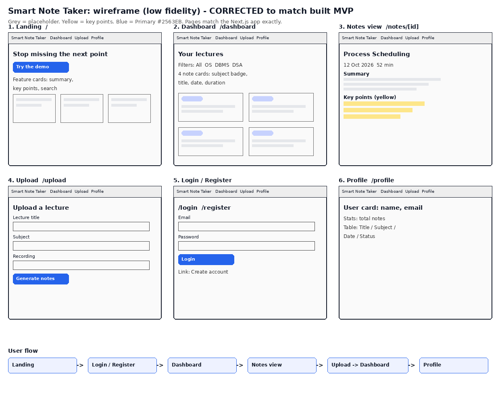
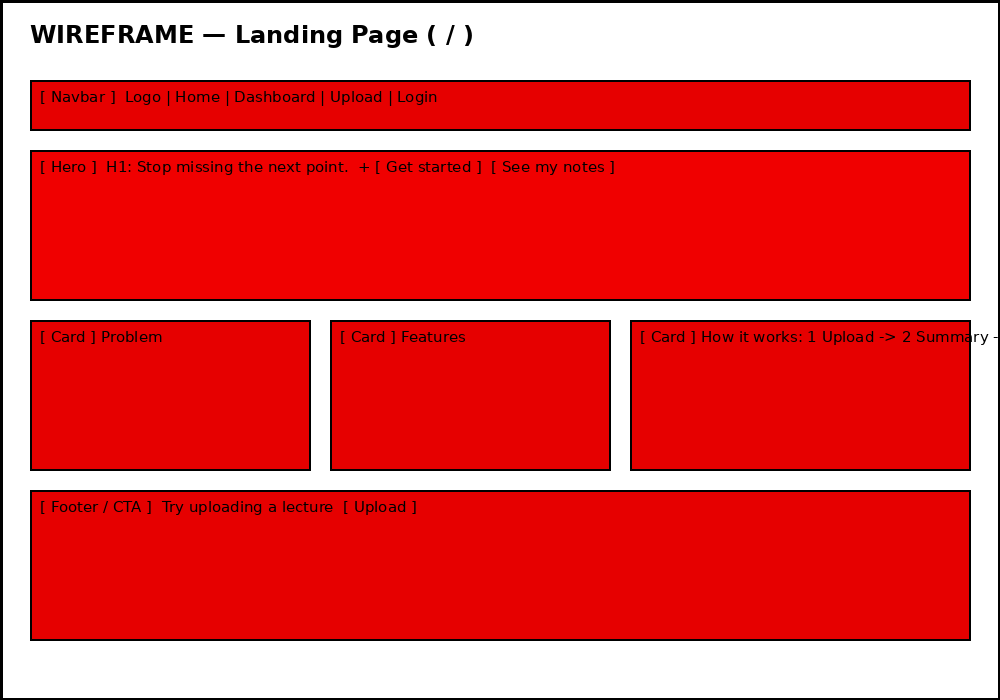
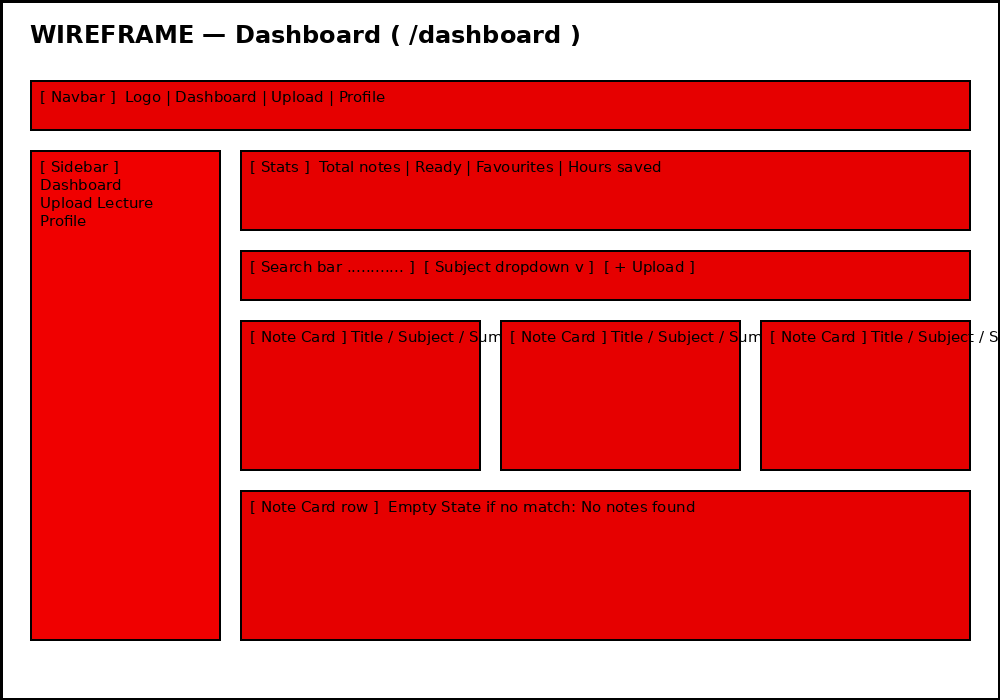
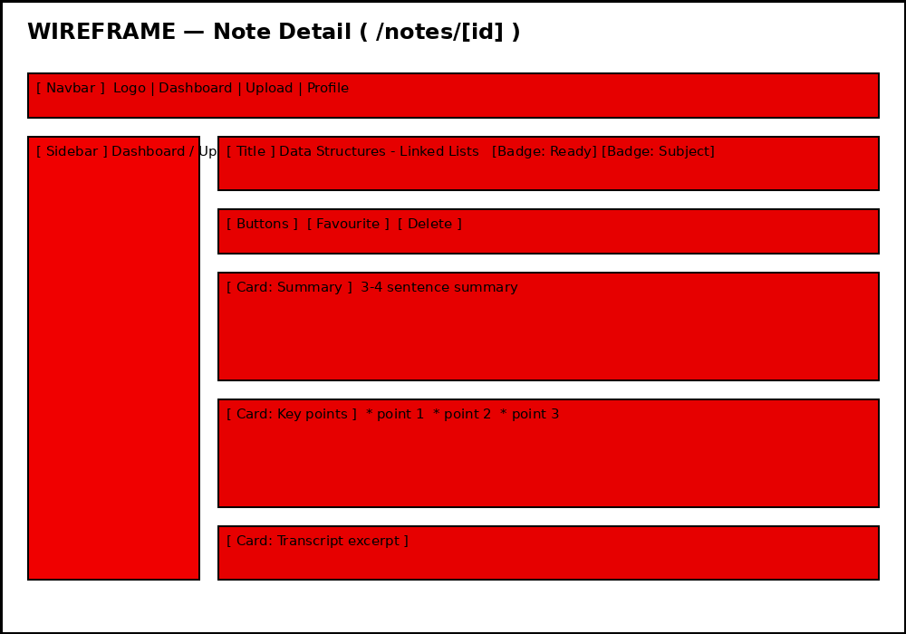

# Smart Note Taker – Wireframe

> Images: `wireframe/wireframe-landing.png`, `wireframe/wireframe-dashboard.png`, `wireframe/wireframe-note-detail.png` — they load on GitHub when the whole repo is viewed together. If you open this .md file alone, the images may show as not found; use the single-file version instead: [WIREFRAME.pdf](wireframe/WIREFRAME.pdf)

Goal: show page structure, navigation, major sections, forms, buttons, cards, and user flow — before coding. Visual perfection is not the objective.

## Corrected overview — use this one



This corrected version matches the built app exactly: Landing, Dashboard, Notes view, Upload, Login/Register, Profile. Do **not** use the earlier Claude draft — it added a Revision page (`/revision/[id]`, with flashcards / score) and a separate Saved page (`/saved`), neither of which is in our MVP or in the code, and it used navy `#1f2a5a` instead of our Primary `#2563EB`.

## User flow

```
Landing (/) → Register / Login → Dashboard (/dashboard)
  → Upload (/upload) → Processing (1.5s, simulated) → Dashboard (new note on top)
  → Note Detail (/notes/[id]) → Favourite / Delete → Dashboard
  → Profile (/profile) → notes table
```

## Landing — `/`



- **Navbar:** Logo | Home | Dashboard | Upload | Login
- **Hero:** H1 "Stop missing the next point", short problem line, buttons [Get started free] [See my notes]
- **Problem section:** one paragraph — students miss the next point while writing
- **Features:** 4 cards — Upload, Short summary, Key points, Search
- **How it works:** 1 Upload → 2 Summary + key points → 3 Revise
- **CTA:** Try uploading a lecture

## Dashboard — `/dashboard`



- **Navbar** (same as landing) + **Sidebar:** Dashboard | Upload Lecture | Profile
- **Stats row:** Total notes | Ready to revise | Favourites | Hours saved
- **Toolbar:** Search bar + Subject dropdown + [+ Upload lecture] button
- **Cards grid:** NoteCard per note — subject badge, status badge (Ready / Processing), title, lecturer/date/duration, summary excerpt, key-points count, [Open note] + [Favourite]
- **Empty State:** "No notes found" when search/filter matches nothing

## Note Detail — `/notes/[id]`



- **Header:** Back to dashboard, title, subject + status badges, tags
- **Actions:** [Mark as favourite] [Delete note] (delete asks for confirmation in a Modal)
- **Summary card:** 3–4 sentence summary
- **Key points card:** highlighted bullet list (amber left border)
- **Transcript card:** transcript excerpt

## Login / Register — `/login`, `/register`

- Centred card form: Email + Password (login); Full name + Email + Password (register)
- Button: [Login] / [Create account]; link to the other page
- On success: redirect to `/dashboard` (dummy auth — any email/password works)

## Upload — `/upload`

- Sidebar + form card: Lecture title, Subject (dropdown), Lecturer, Duration, Recording file name, Transcript textarea
- Button: [Generate my notes]
- Loading State: spinner + "Processing your lecture…" for 1.5s (simulated), then redirect to Dashboard with the new note on top

## Profile — `/profile`

- User card (name, email, totals), Table of all notes (Title / Subject / Date / Status), Settings placeholder card
